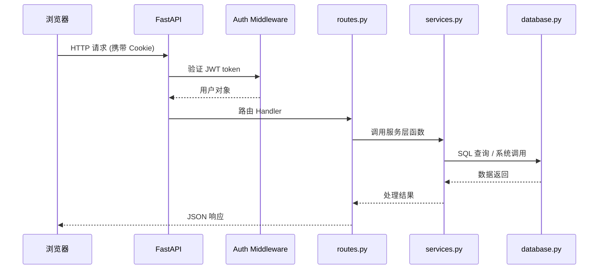
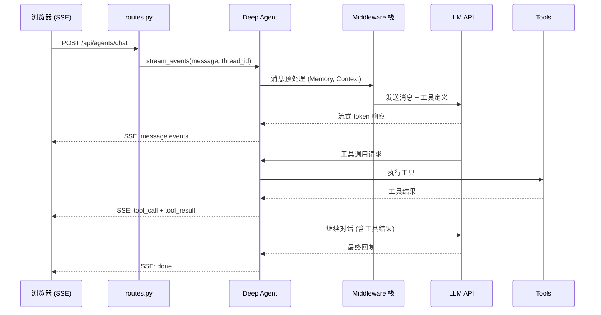
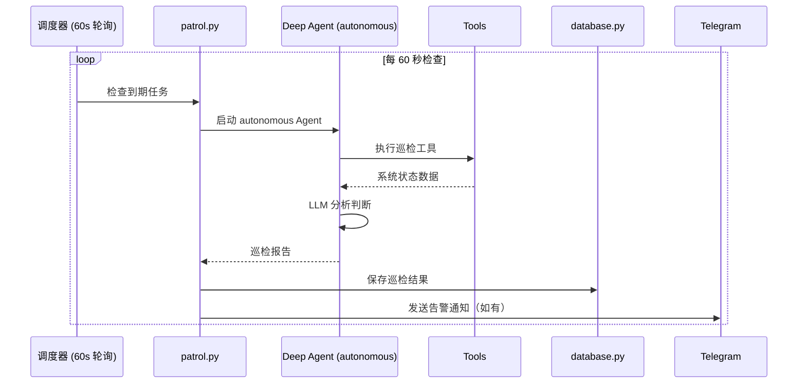

# ServerHub 架构设计

本文档描述 ServerHub 的整体架构设计，包括分层结构、模块自发现机制、AI 智能体架构、认证体系以及核心数据流。

---

## 目录

1. [三层架构](#1-三层架构)
2. [模块自发现机制](#2-模块自发现机制)
3. [AI 智能体架构](#3-ai-智能体架构)
4. [认证体系](#4-认证体系)
5. [数据流图](#5-数据流图)
6. [目录结构](#6-目录结构)

---

## 1. 三层架构

ServerHub 采用经典三层架构，每层职责明确：

```
┌─────────────────────────────────────────────┐
│           路由层 (routes.py)                 │
│  HTTP 请求处理、参数校验、认证依赖注入          │
├─────────────────────────────────────────────┤
│           服务层 (services.py)               │
│  业务逻辑、系统调用、数据处理、外部集成          │
├─────────────────────────────────────────────┤
│           数据层 (database.py)               │
│  SQLite 读写、数据持久化、查询构建              │
└─────────────────────────────────────────────┘
```

### 路由层（routes.py）

- 定义 FastAPI 路由 Handler
- 使用依赖注入处理认证（`get_current_user`, `require_role`）
- 不包含业务逻辑，直接调用服务层

```python
@router.post("/restart/{service_name}")
async def restart_service(
    service_name: str,
    user=Depends(require_role("admin"))
):
    result = await services.restart_service(service_name)
    return {"ok": True, "result": result}
```

### 服务层（services.py）

- 实现业务逻辑（系统命令调用、数据加工、外部 API）
- 可被路由层和 Agent 工具层复用
- Agent 的 `@tool` 函数通过导入 services 复用业务逻辑

```python
# tools.py 中复用 services
@tool
async def list_docker_containers() -> str:
    from modules.docker.services import list_containers
    containers = await list_containers(all=True)
    ...
```

### 数据层（database.py）

- `get_db()` 返回全局单例 aiosqlite 连接
- `init_tables()` 在启动时自动建表
- 所有表定义集中在此文件，便于维护

---

## 2. 模块自发现机制

### 工作原理

`modules/__init__.py` 实现了自动发现逻辑：

1. 遍历 `modules/*/` 所有子目录
2. 跳过以 `_` 开头的目录（如 `__pycache__`）
3. 检查每个目录是否存在 `__init__.py`
4. 动态导入并读取 `MODULE_INFO` 和 `router`
5. 按 `order` 字段排序

```python
def discover_modules():
    for item in sorted(package_dir.iterdir()):
        if not item.is_dir() or item.name.startswith("_"):
            continue
        mod = importlib.import_module(f"modules.{item.name}")
        info = getattr(mod, "MODULE_INFO", None)
        router = getattr(mod, "router", None)
        if info and router:
            _modules.append({**info, "router": router})
```

`main.py` 的 `lifespan` 函数在应用启动时调用 `discover_modules()`，自动将所有模块的 router 注册到 FastAPI app。

### 注册流程

```
应用启动
  └── lifespan() 被调用
       ├── get_db()           # 初始化数据库
       ├── ensure_admin()     # 确保管理员账户存在
       ├── discover_modules() # 扫描所有模块
       │    ├── 加载 modules/dashboard/
       │    ├── 加载 modules/docker/
       │    ├── ... (按字母顺序)
       │    └── 加载 modules/users/
       ├── app.include_router(router) # 注册所有路由
       ├── start_scheduler()   # 启动指标采集（60s 间隔）
       └── start_patrol_scheduler()  # 启动 AI 巡检调度器
```

### 新增模块只需

1. 创建 `modules/<name>/` 目录
2. 在 `__init__.py` 中导出 `MODULE_INFO` + `router`
3. 重启应用，模块自动出现在侧边栏

---

## 3. AI 智能体架构

### 整体结构

```
modules/agents/
├── deep_agent.py     # 工厂函数，组装所有组件
├── llm.py            # 8 家 LLM 服务商注册表
├── tools.py          # 22 个服务器管理工具
├── subagents.py      # 3 个 SubAgent 定义
├── safety.py         # 审批规则 + Shell 黑名单
├── sandbox.py        # SafeLocalShellBackend
├── prompts.py        # 系统提示词（支持自定义覆盖）
├── patrol.py         # 8 个内置巡检任务 + 调度器
├── routes.py         # SSE 对话流 + 所有 API
└── terminal.py       # WebTerminal (pty.fork)
```

### Deep Agents 框架组装

`create_deep_agent()` 工厂函数按以下顺序组装 Agent：

```
create_deep_agent()
  ├── model          # get_chat_model("chat") → ChatOpenAI
  ├── tools          # [get_system_overview, list_docker_containers, ...]
  ├── backend        # SafeLocalShellBackend(root_dir=~)
  ├── middleware     # [ModelRetry, ToolRetry, ModelCallLimit, ContextEditing]
  ├── subagents      # [researcher, log-analyzer, security-auditor]
  ├── checkpointer   # AsyncSqliteSaver(agent-checkpoints.db)
  └── store          # AsyncSqliteStore(agent-store.db)
```

### 安全沙箱（SafeLocalShellBackend）

继承自框架的 `LocalShellBackend`，增加两项安全加固：

1. **环境变量剥离**：移除所有匹配 `*API_KEY*`、`*SECRET*`、`*TOKEN*` 的环境变量，防止 Agent 泄露凭证

2. **资源限制**：在 `/tmp/serverhub-sandbox/` 目录内执行时自动添加 ulimit：
   - CPU 时间：`agent_shell_timeout`（默认 30 秒）
   - 输出长度：截断超过 `agent_shell_max_output`（默认 8000 字节）的输出

### 安全模式

| 模式 | 触发场景 | 行为 |
|------|---------|------|
| `supervised`（监督）| 人工对话 | 危险操作触发 `interrupt_on` 审批，等待用户确认 |
| `autonomous`（自主）| 巡检任务 | 不中断，但 Shell 黑名单仍生效（如禁止 `rm -rf /`） |

审批规则由 `safety.py:build_interrupt_config()` 生成，包含：
- `always` 类：`kill_process`（总是需要审批）
- `supervised` 类：`restart_docker_container`, `restart_systemd_service` 等（监督模式需审批）

### 记忆系统

```
短期记忆 ──── AsyncSqliteSaver checkpoint
               └── 每轮对话的完整状态（工具调用历史、消息）
               └── 存储在 data/agent-checkpoints.db

长期记忆 ──── data/agent-memory.md + MemoryMiddleware
               └── Agent 通过 edit_file() 自主更新
               └── 每次对话开始时注入系统提示词

结构化存储 ── AsyncSqliteStore
               └── namespace + key-value 格式
               └── 存储在 data/agent-store.db
```

### SSE 实时流

对话通过 Server-Sent Events (SSE) 流式推送到前端：

| 事件类型 | 含义 |
|---------|------|
| `message` | Agent 文本输出（流式） |
| `tool_call` | 工具被调用（显示工具名和参数） |
| `tool_result` | 工具执行结果 |
| `todo_update` | 任务列表更新（TodoList Middleware） |
| `approval_request` | 等待用户审批（HumanInTheLoop） |
| `done` | 对话完成 |
| `error` | 错误信息 |

---

## 4. 认证体系

### JWT Cookie 认证

```
用户登录 POST /auth/login
  └── 验证用户名/密码
  └── 生成 access_token（JWT，24小时）
  └── Set-Cookie: access_token=...; HttpOnly; SameSite=Strict

后续请求
  └── 浏览器自动携带 Cookie
  └── FastAPI 依赖注入解析 token
  └── 验证签名 + 过期时间
  └── 返回用户对象
```

`access_token` 存储在 HttpOnly Cookie，JavaScript 无法读取，防止 XSS 窃取。

### RBAC 角色权限

| 角色 | 权限 |
|------|------|
| `admin` | 完全控制：读取 + 写入 + 管理所有模块 |
| `user` | 只读监控：仅可查看仪表盘和监控数据 |

### 依赖注入

```python
from auth.dependencies import get_current_user, require_role

# 仅验证登录
async def handler(user=Depends(get_current_user)):
    ...

# 验证管理员角色
async def admin_handler(user=Depends(require_role("admin"))):
    ...
```

页面路由重定向未登录用户到 `/login`，API 路由返回 401/403。

---

## 5. 数据流图

### 普通 HTTP 请求流程



### AI 对话流程



### 巡检任务流程



---

## 6. 目录结构

```
server-hub/
├── main.py                    # 应用入口，lifespan，页面路由
├── config.py                  # 配置管理 (Settings 单例)
├── database.py                # 数据库初始化和访问
│
├── auth/                      # 认证系统
│   ├── routes.py              # /auth/login, /auth/logout
│   ├── dependencies.py        # get_current_user, require_role
│   ├── jwt_handler.py         # JWT 签发和验证
│   ├── user_store.py          # 用户增删改查
│   └── models.py              # 用户数据模型
│
├── modules/                   # 功能模块（自动发现）
│   ├── __init__.py            # discover_modules()
│   ├── dashboard/             # 仪表盘
│   ├── monitoring/            # 历史指标
│   ├── docker/                # Docker 管理
│   ├── services/              # systemd 服务管理
│   ├── users/                 # 用户资源管理
│   ├── logs/                  # 日志浏览
│   ├── cron/                  # 定时任务
│   ├── network/               # 网络状态
│   ├── proxy/                 # 代理管理
│   ├── notifications/         # 通知推送
│   ├── audit/                 # 审计日志
│   ├── panel_users/           # 面板账户管理
│   ├── settings/              # 系统设置
│   ├── assets/                # 资产管理
│   └── agents/                # AI 智能体
│
├── scripts_bridge/            # 运维脚本白名单桥接
│   ├── registry.py            # 可执行脚本注册表
│   └── executor.py            # 沙箱化执行
│
├── templates/                 # Jinja2 HTML 模板
│   ├── base.html              # 基础布局（侧边栏、顶栏、主题）
│   └── *.html                 # 各页面模板
│
├── static/                    # 静态文件（CSS, JS）
│
├── data/                      # 运行时数据（.gitignore）
│   ├── server-hub.db
│   ├── agent-checkpoints.db
│   ├── agent-store.db
│   ├── agent-memory.md        # AI 助手长期记忆（运行时维护）
│   ├── custom_prompt.txt      # 自定义提示词（可选）
│   └── custom_subagents.json  # 自定义 SubAgent（可选）
│
├── docs/                      # 项目文档
├── CLAUDE.md                  # 开发者指引
├── AGENTS.md                  # 仓库协作说明
├── server-hub.service         # systemd 服务文件
└── requirements.txt           # Python 依赖
```
